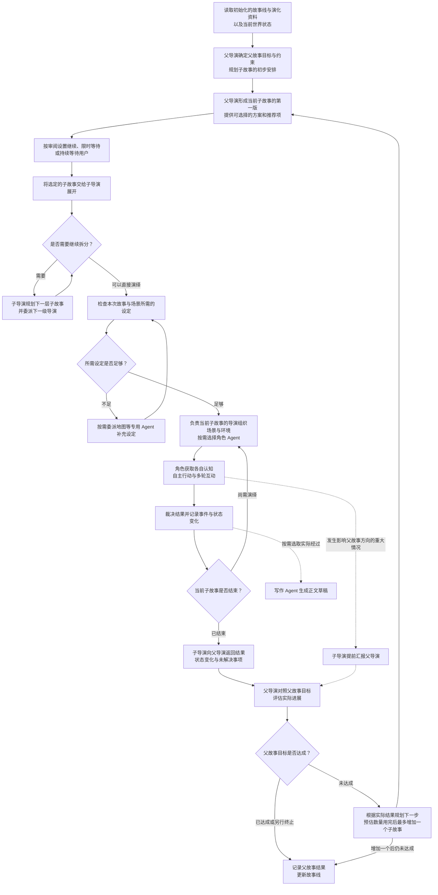

# 故事级工作流

本文是故事级工作流的业务规划，描述目标、主要机制和待确定事项，不代表流程已经实现，也不预设文中建议已获得用户确认。项目的整体方向参见[项目愿景](../../PROJECT_VISON.md)。

## 作用

故事级工作流读取世界初始化时形成的故事线、发展规划、初始局势等演化资料及当前世界状态，由导演逐层组织父故事和当前最小子故事，再通过场景演绎推动故事发展，记录实际结果与世界变化，并为小说写作提供可追溯的素材。世界初始化负责建立起点，其交付范围和依据见[初始化状态、恢复与交付契约](../word-initialization/world-initialization-stage-9-contract.md)；世界运行后，故事工作流还要使用经过核查的当前状态和已发生事件。

世界演化是随时间和事件产生状态变化的系统级概念，故事级工作流是推动演化的重要机制；小说叙事从已经发生的事件中选择、组织和表达内容。三者的业务关系不预设必须分别建立独立工作流。

事件是世界中发生的变化及其组织方式，故事线描述长期或阶段性的发展方向，章节是小说正文的组织单位。一个事件可以横跨多个章节，一个章节也可以包含多个事件；故事线提供方向，不预先规定角色的具体行动和事件结局。

## 总体流程

父导演负责当前层级的整体方向，设定当前子故事的背景、目标和约束后交给子导演；子导演负责展开该子故事。子导演需要继续拆分时，可以作为下一层的父导演继续委派，直到找到适合通过场景直接演绎的最小子故事；“最小”取决于当前任务，不规定固定层级或篇幅。

子导演通常在完成一个子故事的场景、结果记录和必要状态处理后，向父导演返回实际经过的要点、状态变化、未解决事项及必要依据。演绎中出现影响父故事方向的重大情况时，子导演可以提前汇报，由父导演决定如何继续。完整场景经过保留，供需要时查看。预估数量是计划，不要求提前写好所有子故事。

父故事的预估子故事全部进行后，若目标尚未达成，最多增加一个子故事；增加后仍未达成，就根据实际结果调整父故事的相关内容。调整尚未演绎的计划不改变已经发生的事件；已经演绎完成的末尾子故事不能通过重新设定改写历史。写作按需使用已记录的经过，虚线不规定必须在该时点触发。

不同故事线可以在相同或相互交叉的世界时间段内并行发展，分别关注不同角色和事件；流程图展示其中一条故事的展开，并不要求所有故事线串行执行。世界时间需要持续记录，同一角色不能在同一时刻出现在不同地点；涉及同一角色的事件根据世界时间确定先后，前一个事件中该角色的相关行动完成后，再处理后一个事件。必要时可以暂停一个事件，待另一个事件推进到适当位置后继续；角色参与时需要获得其所在事件及此前相关经历的信息。

图中表达业务职责和主要关系，不要求每个方框对应一个固定程序节点。角色互动、信息获取和结果判断可以反复进行；用户可以在何时介入、写作何时触发以及不同事件如何调度，需结合具体场景确定。

图中的设定检查展示场景演绎前的一次检查；父导演和子导演在各自规划过程中也可以随时检查所需资料，并按需委派相应专用 Agent 补充。检查范围取决于当前故事需要，不要求提前完善整个世界。

## 节点

### 1. 确定故事起点

- **输入：**用户选择的世界、初始化交付中形成的故事线及世界发展规划等演化资料、初始局势，以及本次需要关注的范围；已经运行的世界还包括当前状态和既有事件。
- **处理：**核对世界身份，读取相关演化资料、设定、地点、人物、组织、规则和历史。区分长期方向、阶段性目标、初始状态及已发生结果；保留正文或可核验的内容引用、版本、确认范围、留白和未覆盖信息，读取失败和确实没有资料分别呈现。
- **输出与状态：**形成可供本次运行使用的背景和来源依据。缺少必要资料或依据不明确时先暴露问题，不从会话、目录或摘要单独推断世界事实和业务完成。

### 2. 父导演规划故事并委派子导演

- **输入：**初始化演化资料、当前世界状态、已发生事件、故事线和用户提供的目标或选择。
- **处理：**父导演确定本层父故事的背景、需要达成的事项、约束和可观察的评估依据，预估需要多少个子故事并形成初步安排，再形成当前子故事的第一版，包括起点、目标、约束和结束判断。父故事规划完成后，按审阅开关决定是否等待用户；需审阅时可以设置限时等待或一直等待。对可以选择的部分提供选项及推荐项，限时未选择时自动采用推荐项。规划期间可以检查所需设定，缺少必要资料时按需委派对应专用 Agent 补充。若子故事需要继续拆分，子导演在其所在层级承担父导演职责，继续向下委派；后续子故事的具体设定根据实际结果逐个完善。
- **输出与状态：**形成各层故事目标、子故事数量预估、当前子故事的委派内容及适合演绎的最小子故事。父子导演是相对于故事层级的职责，具体 Agent 的创建和调度方式留待设计；目标提供方向，实际结果由演绎决定。

### 3. 子导演为最小子故事组织场景

- **输入：**当前最小子故事的目标和约束、世界规则、相关状态及已有互动结果。
- **处理：**负责最小子故事的子导演根据上级设定检查演绎所需的地图、地点、人物、组织等资料；必要设定不足时，可以委派对应专用 Agent 补充，例如由地图 Agent 完善城门周边地形。补充后结合已有设定和故事需要检查是否足以继续；仍缺少必要信息时说明缺口，而不是假设补充成功。子导演再灵活判断需要多少场景、哪些角色 Agent 参与，以及需要创建或组织的地点、时间、环境、刺激和可感知线索；场景可以随演绎结果追加、调整或结束。
- **输出与状态：**形成供角色参与的场景和需要判断的问题。导演提供处境与方向，角色的心理、具体选择及行动结果仍由后续过程形成。

### 4. 提供角色认知

- **输入：**角色身份、位置、经历、可获知的信息及当前处境。
- **处理：**可信应用按照实际授权和信息来源，为每个角色提供其能够感知或已经知道的内容。世界事实、角色认知、错误认知与未知分别处理；角色不能因为系统保存了全局资料就自动获知全部内容。
- **输出与状态：**各角色得到参与本次互动所需的信息。信息传播、记忆形成和认知更新的具体机制仍需规划。

### 5. 角色行动与互动

- **输入：**角色设定、可知信息、目标、记忆及当前处境。
- **处理：**角色 Agent 自主决定发言、行动、等待或不参与；其他角色可以回应，互动可以进行多轮，并带来新的线索、冲突或子事件。角色的行动首先是尝试，其他人的反应和环境可能影响其结果。
- **输出与状态：**形成行动、对话及待判断事项。具体轮次、角色并发和世界时间如何推进需另行确定。

### 6. 判断结果并记录变化

- **输入：**行动尝试、世界规则、环境和参与者反应。
- **处理：**结合世界规则计算和导演判断确定结果。预留世界规则判断接口；在具体计算规则建立前，默认规则判断返回 `true`，表示规则占位判断通过，不表示行动自动成功，导演仍要结合场景和角色行动进行判断。具体计算规则及两者如何组合留待后续设计。记录实际发生的经过、结果、因果及判断依据，并提出人物、组织、地点、资源、角色认知或记忆等状态变化。
- **输出与状态：**可信应用根据实际权限、版本、冲突处理规则和用户选择决定如何应用变化。事件记录、世界状态、角色认知和会话分别承担职责；会话恢复不能单独证明事件完成或状态写入成功。部分失败或结果不明时先核对记录和实际状态，再决定如何继续。

### 7. 评估子故事、父故事与故事线

- **输入：**已发生的事件、实际状态变化、当前事件和相关故事线。
- **处理：**子导演判断当前子故事是否完成所需场景、结果记录与必要状态处理；尚未结束时继续组织场景，出现影响父故事方向的重大情况时提前汇报。结束后向父导演返回实际结果、状态变化、未解决事项和必要依据。父导演对照父故事需要达成的事项评估进展，结合当前世界状态规划下一个子故事。预估数量已经用完而父故事仍未达成时，最多增加一个子故事；增加后仍未达成，则根据实际结果调整父故事相关内容。父故事目标无法达成、条件改变或需要终止时，记录原因并按权限和用户选择处理。
- **输出与状态：**形成当前子故事结果、父故事进展及下一步决定；父故事结束后可向上评估其父故事，并更新关联故事线。事件、父故事和故事线的结束不要求一定成功。

### 8. 选择素材并进行写作

- **输入：**已记录的事件、可追溯的状态、选定的叙事范围和视角。
- **处理：**选择值得呈现的事件与角色视角，由写作 Agent 组织为正文。写作可以调整表达、节奏和信息揭示顺序，同时区分读者可知与角色可知的信息。
- **输出与状态：**生成与世界事实分开的文学草稿。正文中新出现的重要事实不能仅因写入草稿就自动成为世界事实；写作触发、草稿修订与新事实如何确认需要另行确定。

## 贯穿流程的机制

### 状态与依据

世界状态表达当前事实，事件记录表达经过及结果，角色认知表达特定角色知道或误以为知道的内容，故事线表达发展方向，正文草稿表达叙事内容。它们可以相互引用，但不能互相替代；例如，角色在对话中提出行动，不意味着行动已经成功，小说正文也不自动改变世界状态。

需要保存的状态变化及用户决定应有可核对的身份、版本和来源。持久化格式、迁移或拒绝读取策略、写入冲突及失败恢复方案需要在具体实现前确定；不能把进程内协调、Session 或多个文件的写入当作跨进程锁或跨文件事务。

各 Agent 自身的会话、记忆等数据保存在对应 Agent 的数据中；程序另外保存父子故事、场景、时间、调度及执行进度等运行数据，并关联所需的 Agent 数据。恢复时读取相应数据，核对实际进度后继续运行。Agent 的 Session 和记忆有助于恢复其上下文，但不能单独证明业务步骤已完成或世界状态已写入；具体保存格式和恢复方式留待后续设计。

导演及专用 Agent 补充设定时，需要区分已有世界事实、尚未确认或尚未采纳的补充内容，以及仍然留白的信息；由可信应用结合实际权限和用户选择处理补充结果，不因 Agent 返回内容就直接改写已确认资料。补充设定在故事阶段的具体审阅和保存方式留待设计。

### 暂停、恢复与用户介入

暂停时需要保留能够判断事件、互动和状态更新实际进度的依据；恢复时先核查事件记录、相关状态和尚未确定的操作，再决定从何处继续。中断不等于事件完成，停止生成也不自动代表用户放弃已有结果。

父故事形成子故事初步安排后，可以停下来供用户审阅。审阅由开关控制：关闭时继续流程；开启时可以设置等待时长，或一直等待用户。存在可选内容时展示选项和推荐项；限时等待期间用户未选择则自动采用推荐项，并记录为超时自动选择，不冒充用户确认；一直等待时不因时间流逝自动选择。人物死亡等重大变化不需要单独确认。初步安排不是对后续所有子故事细节的提前定稿，后续内容仍根据已经发生的结果逐个完善。

### 并行故事与角色时间

并行故事记录各自的世界时间范围，并协调涉及同一角色的事件：角色在世界时间更早的事件完成相关行动后，后续事件才能使用相应的角色状态和经历。同一角色不能因为两个故事并行而在同一时刻出现在不同地点；必要时暂停其中一个事件，等另一个事件推进后再继续。角色知道自己参与的当前事件，并依据实际经历了解此前参与的事件，不自动获得其他故事线的全部信息。

这种协调可以借鉴锁的思路，避免同一角色的相关行动发生冲突；具体怎样安排时间、占用与释放角色，以及共享世界状态如何协调，留待详细设计。单纯的执行占用不等于已经核对世界时间先后或地点可达性。

## 示例：曲水城与商队

初始化资料中有“曲水城与外来商队的关系逐渐紧张”的发展方向。导演选择“处理城防与商贸之间的矛盾”作为父故事，设定需要了解矛盾起因并推动各方形成处理办法，暂时预估三个子故事；这只是示例中的计划，不预设矛盾一定按指定方式解决。

父导演只详细设定第一个子故事：一支商队夜间抵达，城门按规定关闭，双方需要处理眼前的进城请求。父导演将其交给子导演；子导演发现城门周边地图不足以安排场景时，可以委派地图 Agent 补充所需地形，处理补充结果后再组织城门场景。子导演按需调用守卫和商队领队；守卫知道城防规定和自己观察到的情况，领队知道货物可能变质，双方依据各自认知交涉。

如果守卫不开门、商队在城外扎营，系统记录交涉与扎营的实际结果，并完成必要的状态处理。子导演向父导演返回结果及未解决事项，父导演再根据结果设定下一个子故事，例如围绕次日处理货物展开；是否真会如此，由实际结果决定。三个子故事结束后，如果父故事目标仍未达成，父导演最多增加一个子故事；增加后仍未达成，就根据实际结果调整父故事相关内容，不能改写已经发生的交涉。写作 Agent 可以从记录中选取经过组织正文。

## 后续规划需要确定的问题

1. **用户控制：**审阅开关、等待时长和一直等待的具体配置，以及并行故事同时需要用户选择时如何展示。
2. **事件、时间与调度：**并行故事线如何协调同一角色和共享世界状态，角色如何轮流互动，世界时间何时变化，事件切换后如何恢复。
3. **行动结果判断：**世界规则的具体计算、与导演判断的组合方式、是否使用随机因素，以及如何保存依据。
4. **认知、状态与恢复：**信息传播和记忆如何形成，Agent 数据与运行记录如何关联，以及版本冲突、部分失败和结果不确定如何处理。
5. **写作介入：**写作流程及具体触发方式暂不讨论。
