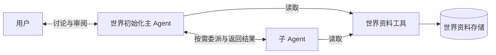
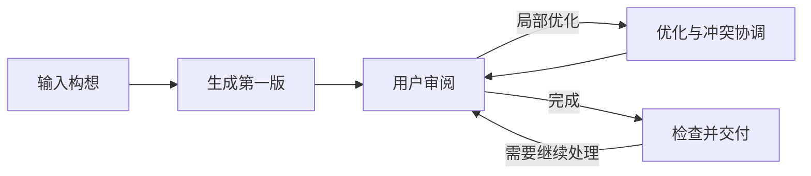
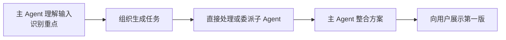
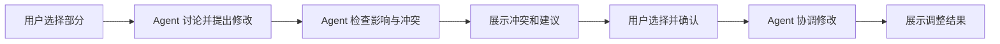

# 世界初始化工作流（整体方案）

本文是世界初始化的技术架构讨论稿。开发顺序和待确认问题见[开发计划](world-initialization-development-plan.md)；现有工作流行为见[工作流模块说明](../../../src/workflow/README.md)。

## 作用

根据用户构想生成并优化世界方案，为后续世界演化提供基础。世界的设定重点由 Agent 识别；规划允许详略不同，并为后续演化保留空白。世界可以产生供多部小说使用的故事，一部小说可以包含多个故事。

## 总体技术架构

- **主 Agent**贯穿初始化过程，与用户协作，理解构想、组织任务、整合方案并协调修改；根据任务决定是否委派。
- **子 Agent**按需处理主 Agent 交付的任务，返回结果供整合；数量与具体职责尚未确定。
- **世界资料工具与存储**提供按需查找和读取，让 Agent 共享同一世界的资料。设计提案见[世界资料共享与读取设计](../../modules/world-information-access.md)。

“世界初始化工作流”是整个协作过程的名称，不预设独立流程控制组件。会话、暂停与恢复、用户确认和资料保存等由什么程序机制承载，需结合实际需求确定。图中的连接表达职责关系，不规定具体接口、调用协议或部署方式；资料写入、草稿和版本管理还需设计。

## 主流程

主 Agent 贯穿主流程，并可按需调用子 Agent。第一版应可整体审阅，但不要求所有内容同样详细；Agent 补充的建议、用户提供的内容和留白需能区分。交付标准及未解决冲突如何处理仍待讨论。

## 子流程：生成第一版

Agent 根据实际世界构想决定规划重点和深度，不使用固定的题材清单。用户审阅时可以识别建议和待定内容，并选择继续优化。

## 子流程：局部优化与冲突协调

主 Agent 可按需委派优化或检查任务；各 Agent 通过资料工具按需获取上下文。用户作出选择时以用户选择为主；用户确认继续但未对某项作出选择时，采用 Agent 的建议。待审修改与当前确认的方案区分。用户是否直接与子 Agent 对话，以及检查发现新冲突后如何继续处理，仍待确定。
